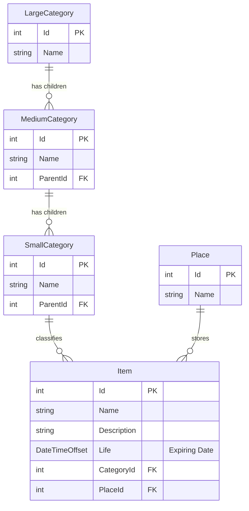

# データモデル (Data Model)

MaxxPro のデータ永続化は、端末ローカルの分離領域（Windows `LocalFolder`）に配置された SQLite データベースファイル（`Caiman.db`）で行われます。

---

## ER図 (Entity-Relationship)



---

## エンティティ詳細仕様

### 1. Item (品目)

備蓄の管理対象となる個々の物品を表すエンティティです。

```csharp
public class Item
{
    public int Id { get; set; }
    public string Name { get; set; } = string.Empty;
    public string Description { get; set; } = string.Empty;
    public DateTimeOffset Life { get; set; } = DateTimeOffset.Now.Date;
    public int CategoryId { get; set; }
    public SmallCategory? Category { get; set; }
    public int PlaceId { get; set; }
    public Place? Place { get; set; }
}
```

- **`Id`**: データベース主キー（自動採番）。
- **`Name`**: 品目名称（例: `5年保存水 2L`）。
- **`Description`**: 備考や入数、利用上の注意（例: `6本入り 1ケース`）。
- **`Life`**: 賞味期限または消費期限を表す `DateTimeOffset`。データベース上は ISO 8601 文字列形式で保存され、デフォルト値は `datetime('now') || 'Z'` です。
- **`CategoryId`**: 所属する `SmallCategory` の外部キー。
- **`PlaceId`**: 所属する保管場所 `Place` の外部キー。

### 2. Place (保管場所)

物資を保管する物理的ロケーションを表すエンティティです。

```csharp
public class Place
{
    public int Id { get; set; }
    public string Name { get; set; } = string.Empty;
    public HashSet<Item> Items { get; } = [];
    public int ItemsCount => Items.Count;
}
```

- **`Id`**: データベース主キー。
- **`Name`**: 保管場所の名称（例: `パントリー`, `玄関防災リュック`）。
- **`Items`**: 当該保管場所に登録されている品目のコレクション。
- **`ItemsCount`**: 当該保管場所にある品目数を返す算出プロパティ。一覧画面にバインドされます。データベース列として保存される値ではありません。

### 3. カテゴリ階層 (Category Hierarchy)

カテゴリモデルは、基底クラス `Category` を継承する TPH（Table-Per-Hierarchy）マッピング戦略を採用しています。単一の `Category` テーブル内に `Discriminator` 列を用いて大・中・小を区別します。

```csharp
public class Category
{
    public int Id { get; set; }
    public string Name { get; set; } = string.Empty;
}

public class LargeCategory : Category
{
    public ObservableCollection<MediumCategory> Children { get; } = [];
}

public class MediumCategory : Category
{
    public int ParentId { get; set; }
    public LargeCategory? Parent { get; set; }
    public ObservableCollection<SmallCategory> Children { get; } = [];
}

public class SmallCategory : Category
{
    public int ParentId { get; set; }
    public MediumCategory? Parent { get; set; }
    public ObservableCollection<Item> Items { get; } = [];
}
```

- **大分類 (`LargeCategory`)**: 最上位カテゴリ。配下に `Children`（中分類）を保持。
- **中分類 (`MediumCategory`)**: 大分類の `ParentId` を持ち、配下に `Children`（小分類）を保持。
- **小分類 (`SmallCategory`)**: 中分類の `ParentId` を持ち、所属する `Items`（品目）を保持。**品目は必ず小分類に紐づけられます**。

:::note
`CaimanContext` では `LargeCategories`, `MediumCategories`, `SmallCategories`, `Items`, `Places` を `DbSet` として公開しています。カテゴリは継承モデルですが、アプリ側では階層ごとの `DbSet` を使って画面やツールから扱います。
:::

---

## データベース格納場所と自動マイグレーション

SQLite データベースファイルは、以下の Windows アプリケーションローカル領域に作成されます：

```csharp
System.IO.Path.Combine(ApplicationData.GetDefault().LocalFolder.Path, "Caiman.db")
```

アプリケーション起動時（`App.xaml.cs` の `OnLaunched`）において、EF Core のマイグレーションエンジンが自動で実行されます：

```csharp
using (CaimanContext caimanContext = await dbContextFactory.CreateDbContextAsync())
{
    await caimanContext.Database.MigrateAsync();
}
```

これにより、通常利用ではユーザーが手動でデータベースを作成したり、マイグレーションコマンドを実行したりする必要はありません。
