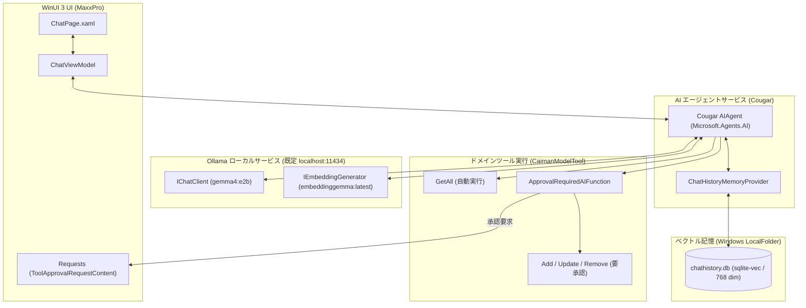
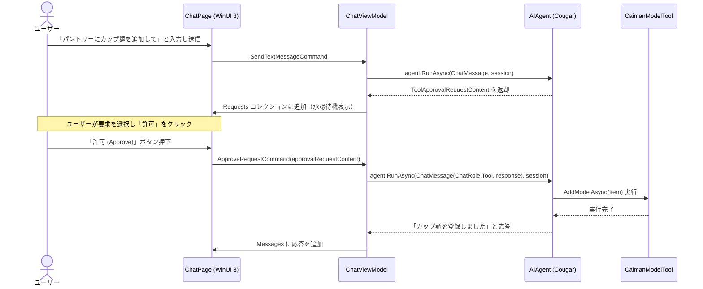

# ローカルAIとツール実行 (Cougar)

MaxxPro に組み込まれているローカルAI機能「**Cougar**」は、プライバシーが保護されたオフライン推論と、安全性を担保した自動ツール実行（Tool Calling）を実現するアーキテクチャを備えています。

---

## アーキテクチャの概要

Cougar は、**Microsoft.Agents.AI** および **Microsoft.Extensions.AI** の抽象化レイヤーを採用し、推論バックエンドとしてローカルで動作する [Ollama](https://ollama.com/) と通信します。



---

## ツール定義と自動公開

`Cougar` は、EF Core の各エンティティ型（`LargeCategory`, `MediumCategory`, `SmallCategory`, `Place`, `Item`）に対して、ジェネリックなツールラッパー `CaimanModelTool<TModel>` を提供します。

各モデル型ごとに以下の4つの関数が生成されます：

1. **`GetAll<TModel>`**:
   - 読み取り専用関数。
   - 承認不要でエージェントによって即時呼び出しされます。
2. **`AddModelAsync<TModel>`**:
   - 新規登録関数（**要承認**）。
3. **`UpdateModelAsync<TModel>`**:
   - 既存データの更新関数（**要承認**）。
4. **`RemoveModelAsync<TModel>`**:
   - データの削除関数（**要承認**）。

:::note
Ollama のポート、チャットモデル、埋め込みモデルは `SettingsViewModel` を通じて Windows の `LocalSettings` に保存されます。既定値はポート `11434`、チャットモデル `gemma4:e2b`、埋め込みモデル `embeddinggemma:latest` です。
:::

### 承認ラッパー（Human-in-the-Loop）の実装

破壊的または状態変更を伴う操作は、すべて `ApprovalRequiredAIFunction` でラップされて AI に渡されます。

```csharp
public IList<AITool> GetAITools()
{
    IList<AITool> aiTools = new List<AITool>();

    // 読み取り操作：承認不要で即座に実行
    AIFunction getFunc = AIFunctionFactory.Create(
        GetAll,
        new AIFunctionFactoryOptions
        {
            Name = nameof(GetAll) + typeof(TModel).Name,
        });
    aiTools.Add(getFunc);

    // 追加操作：ApprovalRequiredAIFunction でラップ（要承認）
    AIFunction addFuncWithoutApproval = AIFunctionFactory.Create(
        AddModelAsync,
        new AIFunctionFactoryOptions
        {
            Name = nameof(AddModelAsync) + typeof(TModel).Name,
        });
    aiTools.Add(new ApprovalRequiredAIFunction(addFuncWithoutApproval));

    // 削除・更新操作も同様に ApprovalRequiredAIFunction で保護
    ...

    return aiTools;
}
```

---

## 承認フロー（Sequence Diagram）

エージェントが変更ツールを呼び出そうとすると、以下の手順で安全に処理が進みます：



---

## ベクトル記憶（sqlite-vec）

過去の会話の文脈を永続化し、適切なコンテキストをエージェントに供給するために `CommunityToolkit.VectorData.SqliteVec` を採用しています。

- **保存ファイル**: Windows `LocalFolder` 内の `chathistory.db`
- **コレクション名**: `chathistory`
- **ベクトル次元数**: 768 次元（`embeddinggemma:latest` に準拠）
- **ユーザー分離**: `storageScope` および `searchScope` に `Environment.UserName` を設定し、OS ユーザーごとに文脈が混ざらないよう分離されています。

## ローカル第一を保つ境界

- Cougar は Ollama のローカルエンドポイントへ接続し、オンラインAIサービスを前提にしません。
- 会話履歴とベクトルデータは `chathistory.db` に保存されます。
- データベース変更ツールは承認要求を経由するため、AI の判断だけでは `Caiman.db` を更新できません。
