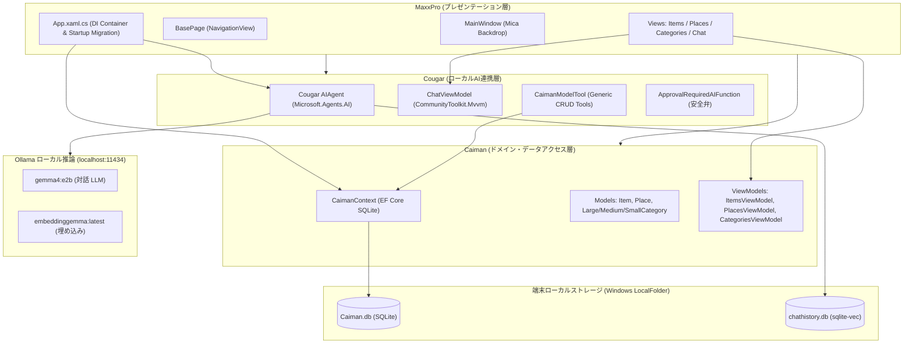

# アーキテクチャ概要

**MaxxPro** は、明確な責務分離と「ローカル第一（Local-First）」原則に基づいて設計されたマルチプロジェクト構成の .NET 10 ソリューションです。

---

## ソリューション構成

すべてのプロジェクトは `net10.0-windows10.0.26100.0` をターゲットとし、単一のソリューションファイル（`MaxxPro.slnx`）で統合管理されています。

```
MaxxPro.slnx
├── MaxxPro      # WinUI 3 デスクトップ アプリケーション本体 (Presentation Layer)
├── Caiman       # ドメインエンティティ、EF Core SQLite コンテキスト & ViewModels (Domain Layer)
├── Cougar       # ローカルAIエージェント、Ollama ツール連携 & sqlite-vec (AI Layer)
└── Buffalo      # Caiman および Cougar の単体・統合テストスイート (Test Layer)
```

| プロジェクト | 種別 | 対象フレームワーク | 主な役割 |
| :--- | :--- | :--- | :--- |
| **`MaxxPro`** | WinUI 3 App | `net10.0-windows10.0.26100.0` | ウィンドウ管理（Mica）、各 Views、ナビゲーション、DI 設定、アプリ起動時マイグレーション。 |
| **`Caiman`** | Class Library | `net10.0-windows10.0.26100.0` | ドメインエンティティ、EF Core 10 SQLite コンテキスト、マイグレーション、各ドメインの ViewModels。 |
| **`Cougar`** | Class Library | `net10.0-windows10.0.26100.0` | `Microsoft.Agents.AI` エージェント、Ollama 通信、`IModelTool<T>`、承認ゲート、会話ベクトル記憶。 |
| **`Buffalo`** | WinUI Unit Test | `net10.0-windows10.0.26100.0` | MSTest を用いた `Caiman` および `Cougar` の自動テストスイート。 |

---

## コンポーネント関連図



---

## 各プロジェクトの詳細責務

### 1. MaxxPro (プレゼンテーション層)
- **テクノロジー**: WinUI 3, Windows App SDK 2.5, Microsoft.UI.Xaml, CommunityToolkit.Mvvm, WinUI.TableView
- **ウィンドウ・ナビゲーション**:
  - `MainWindow` にて `MicaBackdrop` を適用し、Windows 11 に調和した半透明素材とダーク/ライトテーマを提供。
  - `BasePage` の `NavigationView` により、品目一覧、分類管理、保管場所、AI チャットの各ビューへ切り替え。
- **DI & ライフサイクル管理**:
  - `App.xaml.cs` のコンストラクタで `ServiceCollection` を構成し、`Ioc.Default` に登録。
  - `OnLaunched` 時に `CaimanContext` の `Database.MigrateAsync()` を自動呼び出し、ローカルDBスキーマを最新状態へ更新。
- **設定管理**:
  - `SettingsViewModel` が `ApplicationData.GetDefault().LocalSettings` を利用し、Ollama ポート、チャットモデル、埋め込みモデル名を保存。
- **ローカライゼーション**:
  - `Strings/ja-JP`, `Strings/en-US`, `Strings/en-GB` のリソースファイル（`.resw`）による多言語対応。

### 2. Caiman (ドメイン & データアクセス層)
- **テクノロジー**: Entity Framework Core 10, Microsoft.EntityFrameworkCore.Sqlite
- **エンティティ定義**:
  - `Item`: 品目名、説明、期限日（`Life`）、小分類参照（`CategoryId`）、保管場所参照（`PlaceId`）。
  - `Place`: 保管場所名、所属品目セット（`Items`）、計算プロパティ（`ItemsCount`）。
  - `Category`, `LargeCategory`, `MediumCategory`, `SmallCategory`: TPH（Table-Per-Hierarchy）継承による3段階階層。
- **MVVM ViewModels**:
  - `ItemsViewModel` / `ItemViewModel`: 品目一覧の読み込み、CRUD操作、バリデーション。
  - `PlacesViewModel` / `PlaceViewModel`: 保管場所一覧の管理、登録・削除。
  - `CategoriesViewModel` / `CategoryViewModel`: ツリービューと連動したカテゴリの追加・更新・選択変更。
  - `WeakReferenceMessenger`: 各 ViewModel 間の疎結合なデータ同期メッセージ送受信。

### 3. Cougar (ローカルAI連携層)
- **テクノロジー**: Microsoft.Agents.AI, Microsoft.Extensions.AI, OllamaSharp, CommunityToolkit.VectorData.SqliteVec
- **AIエージェント構成**:
  - Ollama のローカルエンドポイント（既定 `http://localhost:11434`）と通信。
  - ポートとモデル名は設定画面から変更可能。
  - `IModelTool<TModel>` および `CaimanModelTool<TModel>` により、5つのエンティティ型（`LargeCategory`, `MediumCategory`, `SmallCategory`, `Place`, `Item`）のCRUDメソッドをエージェントに公開。
- **Human-in-the-Loop 安全設計**:
  - 参照操作（`GetAll...`）は自動実行。
  - 変更・削除操作（`AddModelAsync...`, `UpdateModelAsync...`, `RemoveModelAsync...`）は `ApprovalRequiredAIFunction` でラップされ、ユーザーの承認を要求。
- **ベクトル記憶**:
  - `SqliteVectorStore` を利用し、`chathistory.db` にセッションごとの会話ベクトル（768次元）を保存。

### 4. Buffalo (テスト層)
- **テクノロジー**: MSTest / WinUI Test Framework
- **自動テスト要件 ([AGENTS.md](https://github.com/Tayra-Sakurai/MaxxPro/blob/master/AGENTS.md))**:
  - `Caiman` および `Cougar` のすべてのテストコードをホスト。
  - `FakeCaimanContextFactory` によるSQLiteインメモリ検証。
  - `TestCategoriesViewModel`: カテゴリのロード・追加・検証テスト。
  - `TestChatViewModel`: セッション開始、状態遷移、メッセージ送受信テスト。
  - **ソリューションへの新規プロジェクト追加は禁止**されており、すべての検証は Buffalo で完結します。
