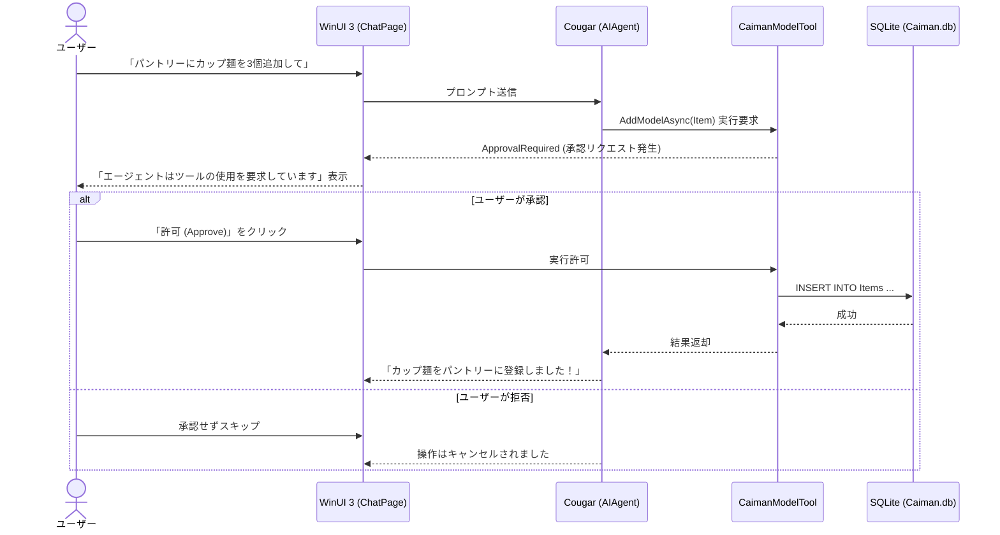

# AIアシスタント「Cougar」

MaxxPro には、Ollama を利用した完全ローカルAIアシスタント「**Cougar**」が統合されています。

---

## 利用前の準備

Cougar を使うには、Ollama がローカルで起動している必要があります。既定設定は次のとおりです。

| 設定 | 既定値 | 説明 |
| :--- | :--- | :--- |
| **Ollama ポート** | `11434` | `http://localhost:11434` に接続します。 |
| **チャットモデル** | `gemma4:e2b` | 自然言語での応答とツール呼び出しに使います。 |
| **埋め込みモデル** | `embeddinggemma:latest` | 会話履歴のベクトル化に使います。 |

これらの値は、アプリの **設定** 画面から変更できます。

:::tip
Ollama が停止していても、品目・分類・保管場所の手動管理は利用できます。Cougar は任意機能です。
:::

---

## ヒューマンインザループ（安全な承認機能）

Cougar は、チャットを通じた問い合わせだけでなく、**データベースの登録・更新・削除などの操作を代行**することができます。

AIが勝手に大切な備蓄データを改ざん・削除してしまう事故を防ぐため、MaxxPro は **ヒューマンインザループ（Human-in-the-Loop）** 機構を実装しています。読み取り操作は自動実行されますが、追加・更新・削除はユーザーの承認が必要です。

---

## 会話例

### 1. 在庫の確認
> **ユーザー**: 「賞味期限が今年中に切れる品物はある？」  
> **Cougar**: 「確認しました。以下の品物が今年中に期限を迎えます：  
> - 缶詰（ツナ缶）：2026年11月15日  
> - アルファ米（チキンライス）：2026年12月01日」

### 2. 品物の登録依頼
> **ユーザー**: 「防災リュックの中に保存用羊羹を1個追加しておいて」  
> **Cougar**: 「以下の内容で登録ツールを実行してよろしいですか？  
> - 名称: 保存用羊羹  
> - 保管場所: 防災リュック  
> - 分類: 保存食」  
> *(画面上部に「許可」ボタンが表示されます)*  
> *(「許可」をクリックするとデータベースに保存されます)*

### 3. 操作を承認しない
> **ユーザー**: 「登録内容が違うのでキャンセルしたい」
>
> **Cougar**: 「承認されていないため、データベースの変更は実行されません。」

---

## ローカルベクトルメモリ

Cougar は、会話履歴をセッションごとにローカルのベクトルデータベース（`chathistory.db` with `sqlite-vec`）に保持します。これにより、過去の会話文脈を踏まえた柔軟な応答が可能です。もちろん、このメモリデータもクラウドには一切送信されません。

## うまく動かないとき

- Ollama が起動しているか確認してください。
- 設定画面のポートが Ollama の待受ポートと一致しているか確認してください。
- チャットモデルと埋め込みモデルを `ollama pull` で取得済みか確認してください。
- 変更操作が進まない場合は、チャット画面上部の承認リクエストを選択してから **「許可」** をクリックしてください。
