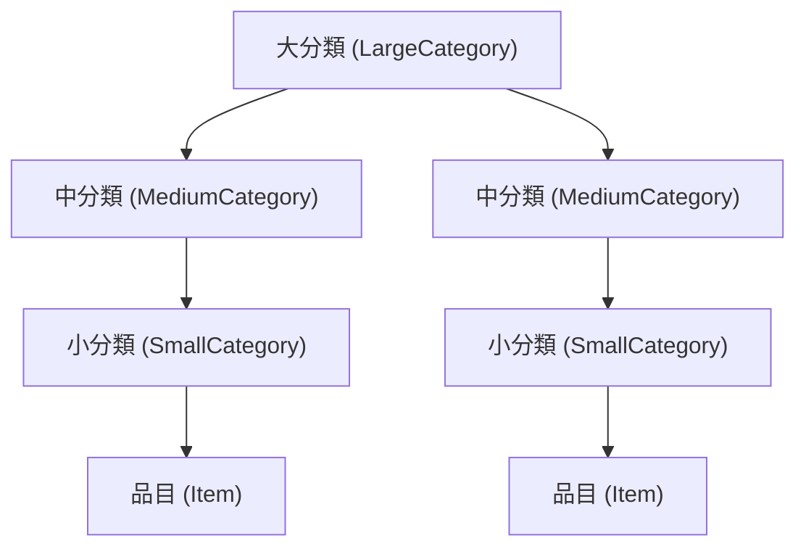

# 分類管理 (Categories)

MaxxPro では、家庭や事業所の多種多様な備蓄品を迷わず整理・検索できるよう、**3段階の階層構造（大分類 > 中分類 > 小分類）** を採用しています。

---

## 階層構造の仕組み

- **大分類 (`LargeCategory`)**: 最上位の管理グループ（例: `非常用食料`, `衛生・生活用品`, `救急・医療`）。
- **中分類 (`MediumCategory`)**: 大分類を細分化したグループ（例: `主食・レトルト`, `保存水`, `簡易トイレ・排泄処理`）。
- **小分類 (`SmallCategory`)**: 中分類に属する末端のグループ（例: `アルファ化米`, `乾パン`, `長期保存水 2L`）。**備蓄品目（`Item`）はこの小分類に直接紐づきます**。

:::tip
分類は「探すときの言葉」で設計すると使いやすくなります。商品名やメーカー名は品目の名称・説明に残し、分類は用途や種類を表す粒度にすると重複を避けられます。
:::

---

## 画面構成とツリービューの操作

分類管理画面（`CategoriesView`）は、**カテゴリツリー表示**、**編集パネル**、**コマンドバー**で構成されます。

### 1. ツリーに応じた階層別追加ルール

コマンドバーの **「追加」** ボタンは、**ツリーで現在選択している項目** に応じて自動的に次の階層を生成します：

| ツリー上の選択状態 | 「追加」ボタン押下時の動作 | 作成される階層 |
| :--- | :--- | :--- |
| **未選択**（選択なし） | 新規の大分類登録フォームが開きます。 | **大分類 (`LargeCategory`)** |
| **大分類** を選択中 | 選択した大分類を親とする中分類の登録フォームが開きます。 | **中分類 (`MediumCategory`)** |
| **中分類** を選択中 | 選択した中分類を親とする小分類の登録フォームが開きます。 | **小分類 (`SmallCategory`)** |

:::caution
小分類に品目が登録されている場合、その小分類を削除すると関連データに影響します。削除前に対象カテゴリ配下の品目を確認してください。
:::

### 2. 既存カテゴリの編集

1. ツリー上で変更したいカテゴリ（大・中・小のいずれか）をクリックして選択します。
2. コマンドバーの **「編集」** ボタンをクリックします。
3. 下部の編集パネルに選択したカテゴリの情報（所属親カテゴリおよび名称）が読み込まれます。
4. 名称等を修正し、コマンドバーの **「保存」** をクリックします。

---

## コマンドバーのボタン機能

| ボタン名 | アイコン | 動作・役割 |
| :--- | :---: | :--- |
| **追加** | ➕ | ツリーの選択状態に応じた新規カテゴリ（大・中・小）の登録フォームを初期化します。 |
| **編集** | ✏️ | ツリーで選択したカテゴリの情報を編集パネルに読み込みます。 |
| **テーブルを同期** | 📁🔄 | データベースから全階層のカテゴリツリーを再取得して表示を更新します。 |
| **削除** | 🗑️ | 現在編集対象となっているカテゴリをデータベースから削除します。 |
| **保存** | 💾 | 入力した名称でカテゴリを新規保存、または既存カテゴリを更新します。 |
| **同期** | 🔄 | 現在編集中のカテゴリの情報をDBから再取得します。 |

---

## 防災備蓄におすすめの分類設計例

| 大分類 | 中分類 | 小分類 | 具体的な備蓄品例 |
| :--- | :--- | :--- | :--- |
| **非常用食料** | 保存水・飲料 | 長期保存水 (2L) / 携帯水 (500ml) | 5年保存水 2L×6本 |
| | 主食 | アルファ化米 / パスタ / カンパン | 尾西の白飯、災害備蓄用ビスケット |
| | おかず・惣菜 | 肉魚缶詰 / レトルト惣菜 | サバ味噌煮缶、おでん缶、レトルトカレー |
| | 栄養補給・菓子 | 羊羹 / 栄養調整食品 / ドロップ | えいようかん、カロリーメイト |
| **衛生・生活用品** | 衛生・トイレ | 簡易トイレ / からだふきシート | 凝固剤付き非常用トイレ、大判ウェットタオル |
| | 日用品・消耗品 | ラップ / カセットボンベ / ゴミ袋 | 食品用ラップ、イワタニ カセットガス |
| **救急・防災装備** | 救急医療 | 救急箱 / 常備薬 / 絆創膏 | 消毒液、滅菌ガーゼ、解熱鎮痛薬 |
| | 防災装備 | ヘッドライト / 防刃手袋 / ヘルメット | LEDヘッドライト、ホイッスル、折りたたみヘルメット |

## 運用のコツ

- 期限の見直しをしたいものは、分類名に期限ではなく用途を入れます。期限は品目側の `Life` で管理します。
- 同じ品物を複数場所に分けて保管する場合は、分類を増やすのではなく、品目名や説明で数量・保管メモを残します。
- 迷ったときは、最初は少ない分類で始め、実際に探しにくくなったところだけ細分化します。
